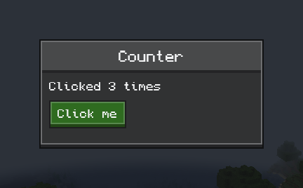

# Getting started

[简体中文](../zh-CN/getting-started.md) · [All guides](../README.md)

This guide adds CompixelUI to a NeoForge 1.21.1 mod and opens a first screen. Other Minecraft versions follow the same steps; [Compatibility](compatibility.md) lists what differs.

## 1. Add the dependency

In your mod's `build.gradle`:

```groovy
plugins {
    id 'org.jetbrains.kotlin.jvm' version '2.4.10'
    id 'org.jetbrains.kotlin.plugin.compose' version '2.4.10'
}

repositories {
    maven {
        url = 'https://maven.wintercogs.com/releases'
        content { includeGroup 'dev.compixel' }
    }
}

dependencies {
    compileOnly "dev.compixel:compixel-neoforge-1.21.1-with-kotlin:${compixel_version}"
    localRuntime "dev.compixel:compixel-neoforge-1.21.1-with-kotlin:${compixel_version}"
}

kotlin { jvmToolchain(21) }
```

And in `gradle.properties`, with the latest version from [Releases](https://github.com/Frostbite-time/CompixelUI/releases):

```properties
compixel_version=<version>
kotlin.stdlib.default.dependency=false
```

The `-with-kotlin` coordinate brings the Kotlin libraries along. If your mod already depends on Kotlin for Forge, use `compixel-neoforge-1.21.1` on both lines instead and let KFF supply Kotlin.

CompixelUI is installed as its own mod, so don't include it in your JAR through Jar-in-Jar.

## 2. Declare the dependency

In `src/main/resources/META-INF/neoforge.mods.toml`, with your own mod ID and the same version:

```toml
[[dependencies.examplemod]]
modId = "compixel"
type = "required"
versionRange = "[<version>]"
ordering = "AFTER"
side = "CLIENT"
```

Use `side = "BOTH"` if you use [menu synchronization](menu-sync.md), which also runs on the server.

## 3. Open a screen

```kotlin
import androidx.compose.runtime.Composable
import androidx.compose.ui.unit.dp
import dev.compixel.forge.ComposeScreen
import dev.compixel.ui.ore.button.OreButton
import dev.compixel.ui.ore.display.OreText
import dev.compixel.ui.ore.layout.OreScreen
import net.minecraft.network.chat.Component

class CounterScreen : ComposeScreen<Unit, Nothing>(Component.literal("Counter")) {
    private var count = 0
    private val clicks by gameState { count }

    @Composable
    override fun Content(state: Unit) {
        OreScreen("Counter", maxWidth = 160.dp, maxHeight = 78.dp) {
            OreText("Clicked $clicks times")
            OreButton("Click me", onClick = { gameThread.post { count++ } })
        }
    }
}
```



Open it with `Minecraft.getInstance().setScreen(CounterScreen())` from client code, such as a key mapping handler. `ComposeScreen` is an ordinary Minecraft screen, and `OreScreen` draws the panel and its title. Keep UI code in client-only classes so a dedicated server never loads it.

The screen keeps its data on the game thread, while Compose draws on its own thread. A `gameState` property reads the data on the game thread and shows the latest value in `Content`, and `gameThread.post` runs a block on the game thread. Here the count lives in the screen: a click adds one on the game thread, and `clicks` shows the new count in the next frame. `Unit` and `Nothing` say that the screen doesn't use the deprecated [snapshots and actions](#snapshots-and-actions).

## 4. Show game data

`gameState` blocks and posted blocks run on the game thread, so they can use players, item stacks and other game objects. This screen shows the item in the player's main hand and drops one on a click:

```kotlin
data class HeldItem(val name: String, val count: Int)

class HandScreen : ComposeScreen<Unit, Nothing>(Component.literal("Hand")) {
    private val held by gameState {
        val stack = Minecraft.getInstance().player?.mainHandItem ?: ItemStack.EMPTY
        HeldItem(stack.hoverName.string, stack.count)
    }

    @Composable
    override fun Content(state: Unit) {
        OreScreen("Hand", maxWidth = 180.dp, maxHeight = 84.dp) {
            OreText("${held.name} × ${held.count}")
            OreButton("Drop one", onClick = { gameThread.post { Minecraft.getInstance().player?.drop(false) } })
        }
    }
}
```

Open it with `Minecraft.getInstance().setScreen(HandScreen())`.

| Member | Runs |
| --- | --- |
| `val x by gameState(intervalTicks) { … }` | Its block runs on the game thread when the screen opens, before the first frame, then every `intervalTicks` ticks (1 by default) and after work posted from an input event. Declare it while the screen is constructed. |
| `gameState(initialValue, intervalTicks, keys) { … }` | The same inside a composable, for state that only part of the content needs: `initialValue` until the first sample at the next tick. New `keys` replace it, and leaving the composition ends it. |
| `gameThread.post { … }` | Queues the block for the game thread, from anywhere, usually UI callbacks. Returns `false` while the screen is closed or 64 blocks and actions are waiting. |
| `Content(state)` | On the Compose thread |

A click, key or typed character that posts work has it run, and every `gameState` read again, before the event returns, just as vanilla buttons act at once; the next frame already shows the result. Work posted at other times, for example from a coroutine, runs at the next tick, which reads everything again too. A block posted by another block waits for the next round.

Reading a `gameState` property only takes the latest value and never runs its block; Compose redraws what reads it when the value changes. Return numbers, strings, data classes or other immutable values, never game objects such as entities, menus or item stacks: an equal value redraws nothing. Keep the blocks to reading the game, and read values that have to match in one block. Requests the server must handle still go through [menu synchronization](menu-sync.md) or your own packets, called inside a posted block.

The screen reads its `gameState` properties before its first frame. When it closes, work not yet run is dropped and the content keeps its last values for its exit; when it opens again, it reads them again. Call `requestClose()` to close it from a button; the screen closes before the click returns.

In `Content`, use only `gameState`, `gameThread` and values prepared in the constructor. Don't touch players, item stacks or other game objects inside composables, and never make Compose wait for the game thread. `ComposeMenuScreen`, `ComposeInventoryScreen` and `ComposeHudLayer` work the same way for [menus and container screens](inventory.md#show-the-menus-state) and [HUD layers](hud.md).

### Snapshots and actions

The screen's type parameters are for an older way to carry the same data. It is deprecated: `snapshot`, `handle` and `send` are removed in 0.2.0, together with the type parameters, so write new screens with `gameState` and `gameThread`. Until then it still works and can be mixed with `gameState`. `snapshot` reads everything into one immutable value of type `S`, `Content` draws the latest one as `state`, and `handle` runs the actions of type `A` that callbacks `send`:

```kotlin
class CounterScreen : ComposeScreen<Int, Unit>(Component.literal("Counter")) {
    private var count = 0

    override fun snapshot() = count

    override fun handle(action: Unit) {
        count++
    }

    @Composable
    override fun Content(state: Int) {
        OreScreen("Counter", maxWidth = 160.dp, maxHeight = 78.dp) {
            OreText("Clicked $state times")
            OreButton("Click me", onClick = { send(Unit) })
        }
    }
}
```

`snapshot` runs at the same moments as a member `gameState` read every tick, and `send` queues actions with the posted blocks, in order. Because `snapshot()` can run more than once per tick, keep it to reading the game.

## 5. Ship it

Players install CompixelUI next to your mod. Each Minecraft version has two files; players pick one:

| File | For |
| --- | --- |
| `compixel-neoforge-1.21.1-…-with-kotlin.jar` | Everyone; Kotlin included |
| `compixel-neoforge-1.21.1-….jar` | Players who already have Kotlin for Forge |

Both are on the [Releases](https://github.com/Frostbite-time/CompixelUI/releases) page.

## Next steps

- [Ore UI](ore-ui.md): every control, with examples
- [Items and tooltips](items.md): real item icons in your UI
- [Container screens](inventory.md): menus with slots
- [Screen transitions](transitions.md): animate screens in and out
- [HUD layers](hud.md): Compose over the game view
- [Menu synchronization](menu-sync.md): server state and client requests
