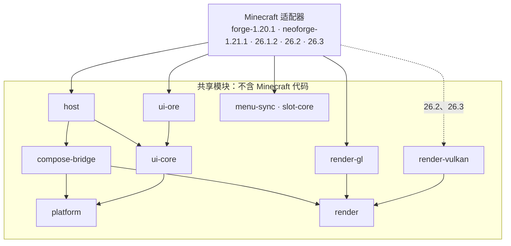
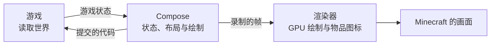

# 架构

[English](../en/architecture.md) · [全部指南](../README.md)

CompixelUI 是一个 Gradle 构建。共享模块包含所有与 Minecraft 无关的代码，每个 Minecraft 版本各有一个适配器把它们接入游戏。

## 模块

| 模块 | 职责 |
| --- | --- |
| `platform` | 与宿主游戏之间的视口、输入、剪贴板等约定 |
| `render` | 帧、GPU 资源与性能统计 |
| `compose-bridge` | 在宿主的 UI 线程运行 Compose，录制帧并绘制原生图像 |
| `host` | 界面会话、`gameState` 订阅、`ScreenTransition`、玩家的颜色选择，以及所有界面和 HUD 层共用的 Compose 层 `UiLayer` |
| `render-gl`、`render-vulkan` | OpenGL 与 Vulkan 渲染器 |
| `ui-core` | 设计系统的接入点：控件反馈、宿主内容外层的设计、弹出层在界面进出场时跟随的可见度、配色，以及担任 Ctrl 作用的 `CtrlOrCmd`（macOS 上为 Cmd，其他系统为 Ctrl） |
| `ui-ore` | Ore UI 组件、颜色、字体与颜色编辑器 |
| `menu-sync` | 菜单同步协议，以及客户端和服务端的会话 |
| `slot-core` | 槽位规则与 Shift 点击路线 |
| `minecraft/<加载器>-<版本>` | 某个 Minecraft 版本的界面、HUD 层、输入、物品、菜单与 GPU 接入 |
| `runtimes/*` | 打包 Compose、Skiko 与独立嵌套的辅助库 |
| `demo`、`desktop`、`testing` | 组件预览、它的桌面窗口以及共享测试代码 |
| `build-logic`、`gradle`、`tools` | 构建约定、版本元数据、检查与脚本 |

## 边界

- 共享模块从不导入 Minecraft 或加载器的类。只有 `render-gl` 和 `render-vulkan` 使用 LWJGL，运行时由游戏提供。
- `menu-sync` 和 `slot-core` 是没有任何依赖的 Java 17 模块，专用服务器加载它们时不会带入界面代码。
- 每个适配器自行管理构建设置、源码和测试；各版本之间不共享源文件。修复需要分别应用到每个受影响的版本。
- 原版容器是基准。虚拟资源、自定义事务等特殊行为属于需要它们的模组。

`verifyCoreBoundary` 是 `check` 的一部分，负责检查前两条规则。

## 线程与帧

一切都运行在 Minecraft 的客户端线程：游戏、Compose 的输入处理、组合、布局和绘制，以及渲染器。在可组合项中调用 `gameState`，立即读取不可变值，之后按刻间隔更新，值变化时内容才会重组。提交的代码在 Compose 处理完事件后、事件返回前执行，并刷新订阅；其他时候提交的代码在下一刻执行。订阅离开组合或会话关闭时结束，保留最后的值用于退场。每一帧先组合和布局，再填入布局所需的槽位、物品图标和物品提示，然后只录制一次，在 Minecraft 自己的图形上下文中绘制：OpenGL 状态在绘制后恢复，Vulkan 使用游戏的设备和队列。

Compose 绘制的 GPU 图像（例如物品图标页）归渲染器所有。Compose 录制的画面会保留对这些图像的引用，渲染器要等这些引用全部释放后才释放图像。

`compose-bridge` 中的 `NativeImageAtlas` 调度物品图标和原生绘制请求的图像，`NativeImageOwner` 通过渲染器释放这些图像，提示图像也不例外。绘制图像、测量提示和处理加载器事件由各适配器负责。

## 打包

- 模组 JAR 包含所有 CompixelUI 模块，不含第三方代码。
- Compose 与 Skiko 打包为运行时包：`compixel-runtime-standard`，以及用于 26.2 和 26.3 的 `compixel-runtime-vulkan`，其中 Skiko 包含 Windows、Linux 和 macOS 的 x64 与 arm64 原生库。共享包的组件合并在运行时包内；包边界独立的库则以原始坐标和 [runtime-library-ranges.properties](../../gradle/runtime-library-ranges.properties) 中定义的兼容范围通过 Jar-in-Jar 嵌套，交由模组加载器与其他模组协商版本。AtomicFU 与 Coroutines Swing 转为自动模块并保留服务声明，以便与各类 Kotlin 运行时模组协同工作。
- 运行时包以 xz 压缩存放这些原生库：同一 CPU 架构的原生库放在同一个压缩流里，以利用它们之间相同的内容；Skia 嵌在 Linux 和 macOS 原生库里的 ICU 数据只存一份。在任何 Compose 代码运行之前，`platform` 中的 `SkikoNatives` 会把当前平台的原生库解压到 Skiko 位于 `~/.skiko` 的缓存目录，Skiko 从那里加载。构建时会还原每个原生库，并与 Skiko 的校验值比对。
- 运行时包改名的库都放在 `dev.compixel.runtime.relocate` 下，这样其他模组自带的副本不会与它们共用同一个包：XZ for Java 位于 `dev.compixel.runtime.relocate.xz`。构建时会相应改写模组 JAR 里对它们的引用。
- 每个运行时包有自己的版本号，`bundle.lock` 记录该版本的确切内容。
- 玩家文件通过 Jar-in-Jar 内嵌运行时包。内嵌包里的文件不单独压缩，由玩家文件对整个包统一压缩。Maven 用户则把运行时包作为依赖获取。
- Ore 字体以 XZ 压缩分发。启动时，各适配器将它解压到隐藏、必需且位于 MC 资源包栈底部的内置资源包，通过 MC 的普通资源管理器提供 `assets/compixel/font/compixel.ttf`。资源包可以替换它，重载后已有界面的排版会更新。`ui-core` 为图片、字体和自定义类型共用按类型解码、缓存租约与重载失效机制，适配器提供资源源。
- Kotlin 运行库由外部 Kotlin 运行时模组提供。启动时，Java 入口会在执行任何 Kotlin 代码之前检查 Kotlin 与 Compose 运行时环境；若 Kotlin 缺失或版本过低，会通过模组加载器的报错页面提示原因和解决方法。

## 接入游戏的方式

优先使用加载器的公开 API。除此之外，每个适配器都声明了少量访问转换器：所有版本都有槽位坐标，1.20.1 还有槽位渲染钩子，26.x 还有容器尺寸、槽位高亮方法、原生预览工厂注册列表和 GPU 后端字段。26.x 适配器另有一个 Mixin，在截取原生绘制、物品图标和提示时把 `GuiRenderer` 的输出导向离屏目标。构建检查会拒绝任何未声明的修改。

## 添加 Minecraft 版本

1. 新建 `minecraft/<加载器>-<版本>`，写好它自己的 `build.gradle` 和 `gradle.properties`，并加入 `gradle/minecraft-targets.properties`。
2. 从最接近的版本移植游戏相关代码。原样复制客户端测试驱动，并为该版本编写 `SuitePlatform.kt`。
3. 构建，在每个图形后端上运行两套客户端测试，并用一个单独安装的模组测试 API。
4. 在文档的版本表格中加入该版本。
