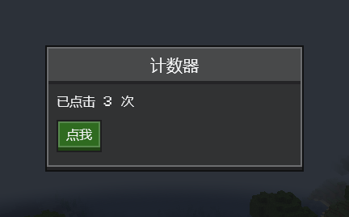

# 快速开始

[English](../en/getting-started.md) · [全部指南](../README.md)

本指南为一个 NeoForge 1.21.1 模组接入 CompixelUI，并打开第一个界面。其他 Minecraft 版本的步骤相同，差异见[兼容性](compatibility.md)。

## 1. 添加依赖

在模组的 `build.gradle` 中：

```groovy
plugins {
    id 'org.jetbrains.kotlin.jvm' version '2.4.10'
    id 'org.jetbrains.kotlin.plugin.compose' version '2.4.10'
}

repositories {
    maven {
        url = 'https://maven.wintercogs.com/releases'
        content { includeGroup 'dev.compixel' }
    }
}

dependencies {
    compileOnly "dev.compixel:compixel-neoforge-1.21.1-with-kotlin:${compixel_version}"
    localRuntime "dev.compixel:compixel-neoforge-1.21.1-with-kotlin:${compixel_version}"
}

kotlin { jvmToolchain(21) }
```

在 `gradle.properties` 中，填入 [Releases](https://github.com/Frostbite-time/CompixelUI/releases) 上的最新版本：

```properties
compixel_version=<version>
kotlin.stdlib.default.dependency=false
```

`-with-kotlin` 坐标会一并带上 Kotlin 库。如果你的模组本来就依赖 Kotlin for Forge，两行都改用 `compixel-neoforge-1.21.1`，由 KFF 提供 Kotlin。

CompixelUI 作为独立模组安装，不要用 Jar-in-Jar 打进你的 JAR。

## 2. 声明依赖

在 `src/main/resources/META-INF/neoforge.mods.toml` 中，换成你的模组 ID，版本与上面相同：

```toml
[[dependencies.examplemod]]
modId = "compixel"
type = "required"
versionRange = "[<version>]"
ordering = "AFTER"
side = "CLIENT"
```

如果用到[菜单同步](menu-sync.md)，它也在服务端运行，请改为 `side = "BOTH"`。

## 3. 打开界面

```kotlin
import androidx.compose.runtime.Composable
import androidx.compose.ui.unit.dp
import dev.compixel.forge.ComposeScreen
import dev.compixel.ui.ore.button.OreButton
import dev.compixel.ui.ore.display.OreText
import dev.compixel.ui.ore.layout.OreScreen
import net.minecraft.network.chat.Component

class CounterScreen : ComposeScreen<Unit, Nothing>(Component.literal("计数器")) {
    private var count = 0
    private val clicks by gameState { count }

    @Composable
    override fun Content(state: Unit) {
        OreScreen("计数器", maxWidth = 160.dp, maxHeight = 78.dp) {
            OreText("已点击 $clicks 次")
            OreButton("点我", onClick = { gameThread.post { count++ } })
        }
    }
}
```



在客户端代码中用 `Minecraft.getInstance().setScreen(CounterScreen())` 打开它，例如在按键绑定的处理函数里。`ComposeScreen` 就是普通的 Minecraft 界面，`OreScreen` 负责绘制面板和标题。界面代码放在仅客户端加载的类里，专用服务器就不会加载它。

界面的数据留在游戏线程，Compose 在自己的线程上绘制。`gameState` 属性在游戏线程读取数据，并在 `Content` 中显示最新值；`gameThread.post` 把一段代码交给游戏线程执行。这里计数保存在界面里：点击时在游戏线程加一，下一帧 `clicks` 就显示新的计数。`Unit` 和 `Nothing` 表示这个界面不使用已弃用的[快照与动作](#快照与动作)。

## 4. 显示游戏数据

`gameState` 的代码块和提交的代码块都运行在游戏线程，可以使用玩家、物品堆等游戏对象。下面的界面显示玩家主手中的物品，点击按钮时丢出一个：

```kotlin
data class HeldItem(val name: String, val count: Int)

class HandScreen : ComposeScreen<Unit, Nothing>(Component.literal("手持物品")) {
    private val held by gameState {
        val stack = Minecraft.getInstance().player?.mainHandItem ?: ItemStack.EMPTY
        HeldItem(stack.hoverName.string, stack.count)
    }

    @Composable
    override fun Content(state: Unit) {
        OreScreen("手持物品", maxWidth = 180.dp, maxHeight = 84.dp) {
            OreText("${held.name} × ${held.count}")
            OreButton("丢出一个", onClick = { gameThread.post { Minecraft.getInstance().player?.drop(false) } })
        }
    }
}
```

用 `Minecraft.getInstance().setScreen(HandScreen())` 打开它。

| 成员 | 何时运行 |
| --- | --- |
| `val x by gameState(intervalTicks) { … }` | 代码块在游戏线程运行：界面打开时、第一帧之前运行一次，之后每 `intervalTicks` 刻（默认 1）运行一次，输入事件提交了代码之后也会运行。在构造界面时声明。 |
| `gameState(initialValue, intervalTicks, keys) { … }` | 用在可组合项中，适合只有部分内容需要的状态：在下一刻首次读取之前为 `initialValue`。`keys` 改变时换成新的订阅，离开组合时结束。 |
| `gameThread.post { … }` | 把代码块交给游戏线程，任意线程都可调用，通常在 UI 回调中。界面已关闭或已有 64 个代码块和动作排队时返回 `false`。 |
| `Content(state)` | 在 Compose 线程 |

点击、按键或输入文字时提交的代码，会在这次事件返回前执行，随后重新读取所有 `gameState`，和原版按钮一样立即生效，下一帧就能看到结果。其他时候提交的代码（例如在协程里）在下一刻执行，那一刻同样会重新读取全部状态。由代码块提交的代码块要等到下一轮。

读取 `gameState` 属性只取最新值，不会运行代码块；值变化时，Compose 重绘读取它的部分。代码块应返回数字、字符串、数据类等不可变值，不要返回实体、菜单、物品堆等游戏对象；值没有变化时不会重绘。代码块只读取游戏状态，需要彼此一致的值放在同一个代码块里读取。需要服务端处理的请求，仍在提交的代码块中通过[菜单同步](menu-sync.md)或你自己的数据包发送。

界面在第一帧之前读取它的 `gameState` 属性。界面关闭时，尚未执行的代码会被丢弃，内容保留最后的值用于退场；再次打开时重新读取。在按钮中调用 `requestClose()` 可以关闭界面，界面会在这次点击返回前关闭。

`Content` 中只使用 `gameState`、`gameThread` 和构造时准备好的值。不要在可组合项里访问玩家、物品堆等游戏对象，也不要让 Compose 等待游戏线程。`ComposeMenuScreen`、`ComposeInventoryScreen` 和 `ComposeHudLayer` 以同样的方式用于[菜单与容器界面](inventory.md#显示菜单状态)和 [HUD 层](hud.md)。

### 快照与动作

界面的类型参数属于传递同样数据的旧写法。它已弃用：`snapshot`、`handle` 和 `send` 将在 0.2.0 与类型参数一起移除，新界面请使用 `gameState` 和 `gameThread`。在此之前它仍然可用，也可以和 `gameState` 混用。`snapshot` 把全部数据读成类型为 `S` 的一个不可变值，`Content` 以 `state` 绘制最新的值，`handle` 执行回调通过 `send` 发来的、类型为 `A` 的动作：

```kotlin
class CounterScreen : ComposeScreen<Int, Unit>(Component.literal("计数器")) {
    private var count = 0

    override fun snapshot() = count

    override fun handle(action: Unit) {
        count++
    }

    @Composable
    override fun Content(state: Int) {
        OreScreen("计数器", maxWidth = 160.dp, maxHeight = 78.dp) {
            OreText("已点击 $state 次")
            OreButton("点我", onClick = { send(Unit) })
        }
    }
}
```

`snapshot` 与每刻读取的成员 `gameState` 在相同的时机运行，`send` 发出的动作和提交的代码块按顺序排在同一个队列里。由于 `snapshot()` 每刻可能调用不止一次，它只应读取游戏状态。

## 5. 发布

玩家把 CompixelUI 和你的模组装在一起。每个 Minecraft 版本有两个文件，玩家选其一：

| 文件 | 适用于 |
| --- | --- |
| `compixel-neoforge-1.21.1-…-with-kotlin.jar` | 所有玩家，已包含 Kotlin |
| `compixel-neoforge-1.21.1-….jar` | 已安装 Kotlin for Forge 的玩家 |

两个文件都可以在 [Releases](https://github.com/Frostbite-time/CompixelUI/releases) 页面下载。

## 下一步

- [Ore UI](ore-ui.md)：所有控件及示例
- [物品与提示](items.md)：在界面中显示真实物品
- [容器界面](inventory.md)：带槽位的菜单
- [进出场动画](transitions.md)：为界面添加入场与退场动画
- [HUD 层](hud.md)：游戏画面上的 Compose 内容
- [菜单同步](menu-sync.md)：服务端状态与客户端请求
